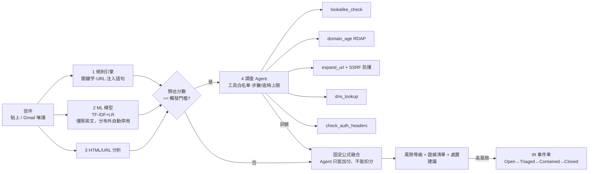

# 基於 AI Agent 之詐騙與釣魚電子郵件偵測、可解釋分析與事件回應系統

線上展示：<https://phishing-detector-n8rv.onrender.com>

輸入一封信（貼上內容，或授權 Gmail 唯讀掃描），系統輸出：**風險分數與等級 → 為什麼可疑（可驗證的證據）→ 調查過程 → 建議處置 → 可追蹤的事件單**。

## 設計重點（一句話版）

> **LLM 只負責「調查與說明」，不負責「判決」。** 分數由證據用固定公式算出；LLM 被攻陷時，最壞情況也無法把風險壓低。

## 系統架構



| 層 | 做什麼 | 關鍵限制 |
|---|---|---|
| 規則引擎 | 台灣常見詐騙用語、URL 風險、對 AI 下指令的語句 | 關鍵字偏中文，對無連結詐騙較弱（見評估） |
| ML | TF-IDF + Logistic Regression | 英文語料訓練；輸入超出分布時 `ml_reliability` 將其移出融合 |
| Agent | LLM 以 function calling 呼叫 5 個工具查證 | 工具目標必須來自信件；最多 `MAX_STEPS` 步、有逾時；分數由 `SIGNAL_POINTS` 計算 |
| 融合 | 規則/ML/HTML/Agent 固定權重 | Agent 只加分：「查不到問題」≠ 安全 |
| IR | 事件單 + 狀態機 + 稽核時間軸 | 嚴重等級由分數決定、不採 LLM 說法；結案須填說明 |

## 安全設計（對應威脅）

| 威脅 | 防護 | 驗證 |
|---|---|---|
| 信件內容對 LLM 注入指令 | 信件以不可信資料包裝；分數不採 LLM 輸出；注入語句本身加分；LLM 文字結論與證據矛盾時覆蓋 | `eval/injection_eval.py`、`tests/test_injection.py` |
| 誘使 Agent 查內網／雲端 metadata（SSRF） | `expand_url` 僅允許公開位址、80/443、禁帳密；逐跳重驗 | 同上（8 次嘗試，0 通過） |
| 誘使 Agent 查信件以外的目標 | `_dispatch` 檢查目標必須出現在信件或先前工具結果 | `tests/test_agent.py` |
| 偽造寄件者繞過白名單 | 白名單需 DMARC pass 且 header.from 一致 | `tests/` |
| 偽造「系統報告信」繞過分析 | 需 SENT 標籤 + 本人地址 + 主旨標記 | `tests/` |
| Gmail 權限過大 | OAuth 僅 readonly scope；憑證與結果以匿名 uid 隔離 | — |
| 事件單被他人竄改 | 事件綁 uid；僅收 JSON（搭配 SameSite=Lax）；狀態機 + 樂觀鎖 | `tests/test_incidents.py` |

## 評估（完整版見 [`eval/RESULTS.md`](eval/RESULTS.md)）

**請先讀限制**：ML 的 98.4% 是英文公開語料，且只做完全相同文字去重（可能有近似重複洩漏，可用 `eval/leakage_check.py` 量化）；中文評估集為人工撰寫的合成信件，樣本小、信賴區間寬。

| 資料 | n | Recall | 誤報率 | 備註 |
|---|---|---|---|---|
| 中文主測試集（不含 Agent） | 50 | 0.88 | 0.00 | 作者撰寫；正常信全無連結 |
| 中文困難樣本（不含 Agent） | 32 | 0.50 | 0.40 | 正常信帶官方連結、詐騙信無連結；由 AI 助理協助撰寫；**只評估、不調參** |

Agent 的消融實驗與真實 LLM 的注入抵抗力需要網路與 API key，請依下方指令執行並把結果填回 `eval/RESULTS.md`。

## 快速開始

```bash
pip install -r requirements.txt -r requirements-dev.txt
export FLASK_SECRET_KEY=$(python -c "import secrets;print(secrets.token_hex(32))")
export GROQ_API_KEY=...            # 選填：沒有就只跑規則 + ML（Agent 與 IR 文字會降級）
export GOOGLE_CLIENT_ID=... GOOGLE_CLIENT_SECRET=...   # 選填：Gmail 掃描
python flask_app.py                # 或 gunicorn flask_app:app
python -m pytest tests -q          # 89 項
```

重新訓練 ML：把 Phishing Email Dataset 放到 `dataset/phishing_email.csv`，執行 `python train_phishing_model.py`。

## 重現實驗

```bash
python eval/evaluate.py test --errors            # 中文主測試集（離線，不含 Agent）
python eval/build_hard_cases.py && python eval/evaluate.py hard   # 困難樣本
python eval/agent_ablation.py --split all --live                  # Agent 消融（需 GROQ_API_KEY + 網路）
python eval/agent_ablation.py --split all --live --trigger 20     # 掃描觸發門檻
python eval/injection_eval.py --offline          # 惡意假 LLM：驗證確定性護欄
python eval/injection_eval.py --live             # 真實 LLM 的抗注入能力
python eval/leakage_check.py --data dataset/phishing_email.csv    # ML 近似重複洩漏
python eval/import_external.py --help            # 匯入外部語料並去重
```

## 目錄

```
agent.py / agent_tools.py   調查 Agent 與 5 個工具（含 SSRF 防護）
analysis.py                 規則、ML、融合、IR 產生、LLM 輸出消毒
storage.py                  SQLite：掃描紀錄、個人白名單、事件單與狀態機
result_builder.py           組裝結果與事件單
flask_app.py / templates.py 網頁與 API
eval/                       資料集、評估與實驗腳本
tests/                      單元與整合測試
```

## 已知限制與未來工作

- 評估資料皆為合成，缺少真實釣魚語料與真實 Agent 實驗數據。
- Agent 只能加分、不能降低誤報；對「帶官方連結的正常信」的誤報無法由 Agent 修正。
- 觸發門檻（預設 40）以下的漏報，Agent 不會被啟動。
- 品牌清單與 `registrable_domain` 為簡化版（未用 Public Suffix List）；未處理附件與 QR code。
- IR 狀態流轉為人工操作；不會對信箱做隔離／刪除（刻意維持唯讀授權）。
